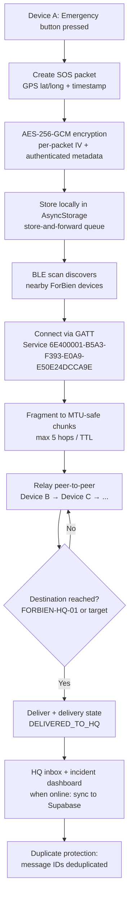

# ForBien

> Offline Bluetooth mesh emergency communication — exchange emergency messages when internet and cellular connectivity are unavailable.

[](./LICENSE)
[](https://expo.dev)
[](https://developer.android.com)
[](https://github.com/BuzzleMax/forbien-network/releases/tag/v1.0.0)

ForBien is an emergency-communication Android application that lets nearby devices exchange SOS and emergency messages over **Bluetooth Low Energy (BLE) mesh networking** — with no internet, no cellular service, and no cloud dependency required for device-to-device messaging. Messages are encrypted, relayed between intermediate devices, and persisted locally so they can be delivered once a path to a headquarters (HQ) node exists.

## Table of contents

- [The problem](#the-problem)
- [How ForBien works](#how-forbien-works)
- [Key features](#key-features)
- [Technology stack](#technology-stack)
- [Installation and usage](#installation-and-usage)
- [Architecture and security](#architecture-and-security)
- [Limitations](#limitations)
- [Roadmap](#roadmap)
- [Contributing](#contributing)
- [Licence and attribution](#licence-and-attribution)
- [Disclaimer](#disclaimer)
- [Credits and contact](#credits-and-contact)

---

## The problem

During disasters and emergencies, cellular networks and internet infrastructure are often the first things to fail — exactly when people need to call for help most. Devices in the same area may be within Bluetooth range of one another, but without a mesh layer they cannot exchange messages or route an SOS to a rescue coordination point.

ForBien is intended to fill that gap: it turns nearby Android devices into an offline, store-and-forward mesh so emergency messages can hop from device to device until they reach an HQ device, even when there is no internet or cell signal.

**Important:** ForBien is a supplementary emergency-communication tool. It is not a replacement for official emergency services (police, fire, ambulance, or your country's emergency number such as 911/112/999), and it does not guarantee that any message will be delivered. See [Disclaimer](#disclaimer).

---

## How ForBien works

ForBien uses Bluetooth Low Energy to discover nearby devices running the ForBien app, encrypts emergency messages, and relays them peer-to-peer through intermediate devices until they reach their destination (for example, a designated FORBIEN-HQ-01 device). Messages are stored locally so they survive while waiting for a relay path or for connectivity to return.



**Implemented vs. intended.** The flowchart above reflects behavior implemented in `src/api/meshLogic.js` (BLE scanning, GATT connection, AES-256-GCM encryption, MTU fragmentation, multi-hop relay with hop limit, duplicate detection, local persistence, and HQ delivery). Internet-backhaul sync to a Supabase HQ backend is part of the architecture but requires a configured Supabase instance and is only reached when connectivity returns; it is not guaranteed in every deployment.

---

## Key features

The following capabilities are implemented in the repository and verified against the source code:

| Feature | Status | Notes |
|---|---|---|
| Nearby Bluetooth device discovery | Implemented | BLE scan for the ForBien mesh service UUID on Android (`src/api/meshLogic.js`). |
| Emergency message transmission | Implemented | `createOfflineEmergencyMessage()` builds SOS packets with priority and text. |
| Multi-hop message relaying | Implemented | `relayMessage()` / `processOutboundQueue()` forward encrypted packets between peers. |
| Hop limit / TTL | Implemented | Default `maxHops` of 5; relay stops when the limit is reached. |
| Duplicate-message protection | Implemented | Message IDs are deduplicated with a time-limited cache (`src/api/meshLogic.js`). |
| Store-and-forward | Implemented | Outbound and persistent queues are saved to AsyncStorage and restored on restart. |
| Message encryption | Implemented | AES-256-GCM with per-packet IV and authenticated associated data (`src/lib/crypto.js`). Legacy XOR packets are rejected. |
| HQ authentication | Implemented | Ed25519-signed HQ handshake; only a provisioned FORBIEN-HQ-01 device is recognized. |
| SOS / rescue requests | Implemented | Emergency message screen, broadcast SOS, and gateway paths (BLE, SMS, emergency call dialer). |
| Latitude/longitude + timestamps | Implemented | GPS captured via `expo-location` and attached to each SOS packet. |
| HQ dashboard / incident management | Implemented (web) | `forbien-hq-web`: live SOS feed, emergency map, missing persons, incident stats (Supabase-backed). |
| Android installation | Implemented | Release APKs are built and distributed (see Installation below). |
| Offline operation | Implemented | Core BLE mesh works with no internet; network-recovery sync to HQ runs when connectivity returns. |

**What is not claimed:** background Bluetooth behaviour, delivery guarantees, delivery speed, and the end-to-end security of the internet backhaul path all depend on device hardware, OS behaviour, and the administrator's backend configuration. These are described honestly in [Limitations](#limitations).

No screenshots or demo videos are currently committed to the repository, so an image gallery is intentionally omitted. Screenshots can be added under `assets/` and linked here in the future.

---

## Technology stack

The technologies below are those actually used in the repository, taken from `package.json`, `app.json`, the Android project, and `forbien-hq-web`.

**Mobile application (Android)**

| Layer | Technology |
|---|---|
| App framework | React Native 0.81.5, React 19, Expo SDK ~54 (`expo ~54.0.35`) |
| Language | JavaScript |
| Bluetooth LE | `react-native-ble-plx` + a custom native Android GATT server module (`BleGattServerModule.java`) for advertising/peripheral mode |
| Local storage | `@react-native-async-storage/async-storage` |
| Navigation | `@react-navigation/native-stack`, `@react-navigation/bottom-tabs`, `@react-navigation/native` |
| Location/GPS | `expo-location` |
| Network monitoring | `expo-network` |
| Cryptography | `@noble/ed25519`, `@noble/hashes`; custom pure-JS AES-256-GCM / SHA-256 fallback (`src/lib/crypto.js`) |
| Message compression | Custom dictionary SOS compression (`src/lib/compression.js`) |
| Build / distribution | EAS (`eas-cli`), Gradle, GitHub Releases APK assets, GitHub Pages landing page |

**Headquarters (HQ) web dashboard**

| Layer | Technology |
|---|---|
| Frontend | Vite, React 18, React Router, Tailwind CSS |
| Backend / database | Supabase (`@supabase/supabase-js`), schema in `database/hq_command_system_schema.sql` |
| Maps | Leaflet / `react-leaflet` |

**Protocol identifiers (implemented)**

- BLE mesh service UUID: `6E400001-B5A3-F393-E0A9-E50E24DCCA9E`
- BLE mesh characteristic UUID: `6E400002-B5A3-F393-E0A9-E50E24DCCA9E`
- HQ node ID: `FORBIEN-HQ-01`

---

## Installation and usage

### Mobile app (Android)

**Prerequisites**
- An Android device with Bluetooth and Location permissions.
- To build from source: Node.js, Expo CLI (`npx expo`), and Android build tooling (or EAS).

**Clone the repository**

```bash
git clone https://github.com/BuzzleMax/forbien-network.git
cd forbien-network
```

**Install dependencies**

```bash
npm install
```

**Run in development**

```bash
npm start          # Expo development server
npm run android    # Run on an attached Android device/emulator
npm run web        # Run the mobile app on web
```

**Install from APK**

Release APKs are published to GitHub Releases (for example, the v1.0.0 tag). Download the APK to your Android device, open it, and install (you will need to allow installation from unknown sources). Then grant the Bluetooth and Location permissions when prompted.

### Headquarters dashboard (web)

The `forbien-hq-web` directory is a separate Vite/React application that connects to a Supabase instance for live SOS monitoring and incident management.

```bash
cd forbien-hq-web
npm install
npm run dev        # local development (Vite)
npm run build      # production build
```

**Configuration required:** `forbien-hq-web/src/supabaseClient.js` reads `VITE_SUPABASE_URL` and `VITE_SUPABASE_ANON_KEY` from environment variables. You must supply your own Supabase project credentials (never commit them). A template is not shipped with real values; configure them per your deployment.

### Backend configuration and secrets

The repository contains a `.env` file with Expo public Supabase configuration used by the mobile app. These values are environment-specific and must not be copied, committed, or shared. Do not extract or publish credentials from `.env`, `forbien-hq-web/.env.example`, or any native configuration files.

---

## Architecture and security

### Message flow

1. A user creates an emergency (SOS) message on the device. GPS latitude/longitude, altitude, accuracy, and a timestamp are captured where location permission is granted.
2. The message is assigned a UUID, timestamped, and persisted to local AsyncStorage immediately (store-and-forward) before any transmission attempt.
3. The payload is compressed (dictionary SOS compression) and encrypted with AES-256-GCM using a per-packet IV and authenticated associated data (message ID, source/destination node, type, timestamp).
4. When mesh mode is enabled, the device scans BLE for nearby ForBien devices (service UUID `6E400001-...`) and, where supported, advertises itself as a connectable peripheral.
5. Encrypted packets are fragmented to fit the negotiated BLE MTU and relayed peer-to-peer. Each relay increments the hop count; relaying stops at the configured `maxHops` (default 5).
6. Intermediate devices do **not** decrypt payloads while forwarding; they only route the encrypted envelope.
7. When the packet reaches its destination (e.g., FORBIEN-HQ-01), the receiving node decrypts and verifies the GCM authentication tag, records the delivery state, and stores the message in its local HQ inbox.
8. Duplicate message IDs are detected and dropped. Stuck messages are re-forwarded on a schedule, and messages expire after 24 hours.
9. When network connectivity returns, pending messages can be synchronized to the Supabase HQ backend.

### Device roles

- **FIELD / RELAY**: originate and forward messages.
- **HQ (FORBIEN-HQ-01)**: receives and acknowledges emergency messages; assumes the HQ role only after Ed25519 cryptographic provisioning with an authorized key stored in the Android Keystore.

### What the code establishes

- BLE discovery, GATT connection, MTU negotiation, and fragmentation/reassembly are implemented natively on Android.
- Encryption at rest is **not** applied to the local message queue (device-level storage is relied upon); see `ARCHITECTURE.md`.
- Transmission uses AES-256-GCM authenticated encryption; legacy XOR packets are explicitly rejected.
- HQ identity is verified by Ed25519 signature, not by UUID alone.

---

## Limitations

Please read these carefully before relying on ForBien in any situation.

- **Bluetooth range and reliability depend on hardware and environment.** Obstacles, interference, radio power, and device placement all affect whether a message reaches the next hop.
- **Device compatibility and OS restrictions affect background Bluetooth operation.** BLE peripheral/advertising behavior varies by Android version and manufacturer; some devices may not support mesh peripheral mode.
- **Emergency messages may fail to arrive.** Delivery depends on a chain of nearby devices being online, in range, and running ForBien with mesh enabled. There is no guaranteed delivery, no delivery receipt to the originator in all paths, and no guaranteed latency.
- **ForBien is not production-secure or formally verified.** Encryption is implemented, but the system has not undergone an independent security audit as part of this repository. Do not treat it as a replacement for verified emergency communication infrastructure.
- **Do not rely on ForBien as your sole means of requesting assistance.** Always retain access to official emergency services and other available communication methods.
- Internet backhaul to Supabase requires a configured backend and valid credentials; it is optional and not part of the offline mesh path.

---

## Roadmap

The following are identified future improvements and are **not** currently implemented in the repository. No dates or release commitments are made.

- Persistent local encryption of the message queue at rest.
- Extended platform support beyond Android (e.g., iOS BLE background behaviour).
- Delivery receipts and end-to-end acknowledgements across multiple hops.
- Additional gateway integrations for alerting when connectivity returns.
- Screenshots and demo assets for the repository.

---

## Contributing

ForBien is developed in the open, but it is **not** a commercial or permissively licensed project. All contributions and reuse are governed by the [PolyForm Noncommercial License 1.0.0](./LICENSE).

Ways to contribute:
- Inspect the source under `src/`, `android/`, and `forbien-hq-web/` and report bugs or unexpected behaviour.
- Suggest improvements through issues or pull requests.
- Improve documentation (this README, `ARCHITECTURE.md`, deployment guides).

**Licence restriction:** because the project is licensed under PolyForm Noncommercial 1.0.0, contributions and forks may not be used for commercial purposes under this licence, and redistribution must include the licence terms and required notices. Do not submit pull requests that assume commercial reuse or relicensing is permitted.

Before contributing, confirm you are comfortable licensing your contributions under the same noncommercial terms, and do not contribute third-party code whose licence conflicts with PolyForm Noncommercial 1.0.0.

---

## Licence and attribution

ForBien is licensed under the **PolyForm Noncommercial License 1.0.0**.

- Official licence text: https://polyformproject.org/licenses/noncommercial/1.0.0
- Repository: https://github.com/BuzzleMax/forbien-network
- Licence file in this repository: [./LICENSE](./LICENSE)

**Plain-language terms:**

- **Noncommercial use** is permitted only within the licence's terms (including personal use and use by qualifying noncommercial organisations such as charities, educational institutions, public safety/health organisations, and government institutions).
- **Modification and redistribution** are permitted only within the licence's terms, and anyone receiving the software must also receive the licence terms or their URL, plus any required-notice lines.
- **Commercial use is not granted** under this licence and requires separate authorization from the rights holder where applicable.
- The **copyright holder retains all rights not granted** by the licence.
- This licence does not provide patent defence if you assert patent claims against the software, and the software is provided "as is" without warranty.

You must follow the complete licence terms, including its applicable notice and redistribution requirements. The complete, unmodified licence text is in [LICENSE](./LICENSE).

**Project credit (separate from the licence's enforceable terms):** this project is developed under the BuzzleMax organisation (https://github.com/BuzzleMax). The project website credits Swapnanil Dowarah as the creator. This credit request is a community courtesy and is not an enforceable term of the PolyForm licence.

Third-party dependencies in `node_modules` are subject to their own licences and are **not** covered by this LICENSE.

---

## Disclaimer

ForBien is an emergency-communication project, **not** a guaranteed replacement for official emergency communication infrastructure. It does not replace police, fire, ambulance, or your country's emergency number. Messages may be delayed, lost, or undelivered depending on device proximity, battery, radio conditions, and software behaviour.

Users must not rely on ForBien as their sole means of requesting assistance. Always maintain access to official emergency services and other available communication methods. The project is provided "as is," without warranty of any kind, to the fullest extent permitted by law.

---

## Credits and contact

- Repository: https://github.com/BuzzleMax/forbien-network
- Issues / bug reports: https://github.com/BuzzleMax/forbien-network/issues
- Organisation: https://github.com/BuzzleMax
- Project website credit: Swapnanil Dowarah (per the project landing page)

No individual email addresses, additional contributors, or partnership organisations are claimed in this README. For contact, open an issue in the repository above.
